# SOMA brand applications

*Digital Art Director · phase B2 · 1 Nov 2026. Every artwork is generated from code (`_src/*.mjs`, HTML/SVG → PNG/PDF with Playwright and the final logo SVGs). To change one, edit the source and rebuild: `node brand/applications/_src/build-all.mjs`.*
*All photographs are **AI-generated development assets** and are labelled as such. All names, prices, codes and numbers are **demo data** (BRAND_VOICE examples), never real bookings.*

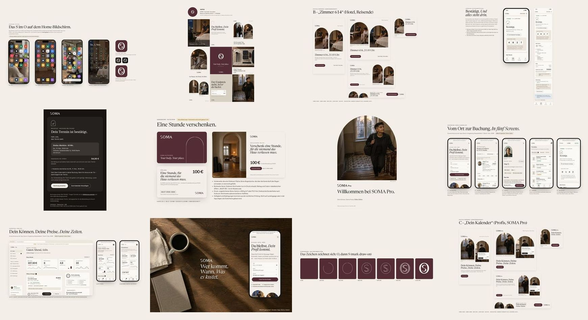

| # | Application | Files | Preview |
|---|---|---|---|
| 1 | **App icons** (new mark: the S in the O): iOS and Android home screens, light and dark (themed icons), App Store 1024 and Play 512; AI wallpapers labelled | `app-icons/app-icons-board.png`, `ios-home-light.png`, `ios-home-dark.png`, `android-home-light.png`, `android-home-themed-dark.png` · masters in `brand/assets/icons/` | 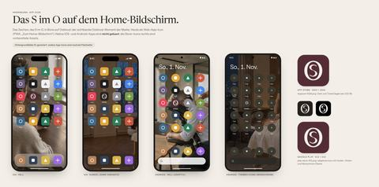 |
| 2 | **Social**: avatar, 9 Instagram posts (1080×1350; post 03 = the signature pair), 3 stories (1080×1920), LinkedIn banner (1584×396), grid preview; AI labels at 22 px | `social/avatar-1080.png`, `social/instagram/post-01…09.png` (`post-03-evening.png` replaces `post-03-arrival.png`), `social/stories/story-01…03.png`, `social/linkedin-banner-1584x396.png`, `social/instagram-grid-preview.png`, `social/captions.md` | 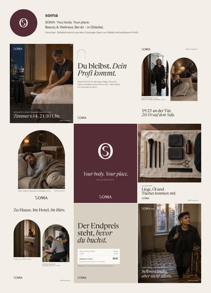 |
| 3 | **Digital advertising**: concepts A „Schon zu Hause“, B „Zimmer 614“, C „Dein Kalender“ × 1080×1080, 1080×1920, 1200×628, 300×250, 728×90. **Every format carries the signature** (offset arch pair + Ortszeile, guidelines § 10.2); the wordmark sits only on calm Bone | `ads/<concept>/<concept>-<size>.png` (15 files) + `ads/<concept>/board.png` | 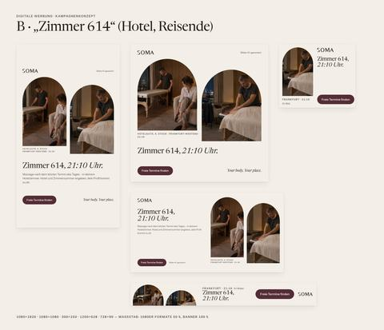 |
| 4 | **Booking confirmation**: mobile 390×844 comp of `/buchung/[id]` (Start-Code, place, time, price, free-cancellation deadline) | `booking-confirmation/booking-confirmed-390x844@3x.png`, `booking-confirmed-full@2x.png`, `board.png` | 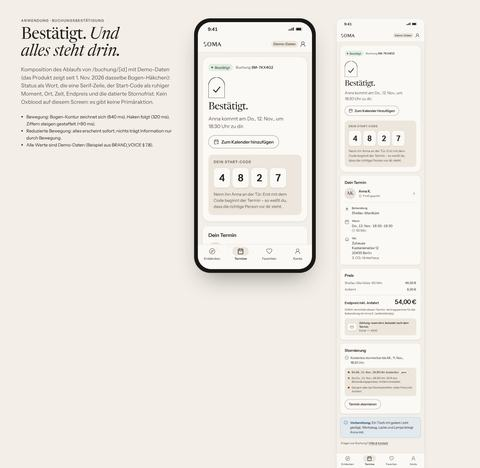 |
| 5 | **Transactional e-mail** „Buchung bestätigt“: table-based, inline styles, dark-mode friendly (`prefers-color-scheme`, Outlook `[data-ogsc]`, swapped logo), bulletproof VML button, preheader, plain text. **Hosted webfonts** (`@font-face`, OFL files in `email/assets/fonts/`) with a stated fallback (Georgia / Arial, MSO override; guidelines § 10.3). **Truthful previews:** webfonts (Apple Mail) vs. fallback (Gmail/Outlook, rendered with metric-compatible Gelasio and Liberation Sans) | `email/template/buchung-bestaetigt.template.{html,txt}` (merge tags) · `email/buchung-bestaetigt.{html,txt}` (filled demo) · `email/preview-board.png`, `preview-webfonts-light-680.png`, `preview-fallback-light-680.png`, `preview-fallback-dark-680.png`, `preview-fallback-mobile-390.png` · `email/assets/` · `email/_preview-fonts/` (preview only) | 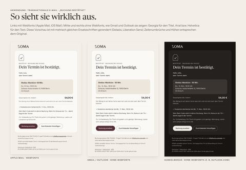 |
| 6 | **Gift card**: **future concept, not built (v1.1)**. Physical ID-1 front/back at 300 dpi, a print PDF with 3 mm bleed, digital 1200×760 | `giftcard/physical-front-85.6x54mm@300dpi.png`, `physical-back-…png`, `giftcard-print-91.6x60mm-bleed.pdf`, `digital-1200x760.png`, `board.png` | 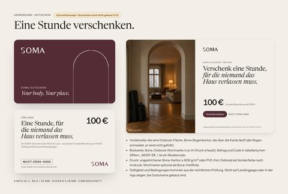 |
| 7 | **SOMA Pro welcome kit**: A4 PDF, 7 pages (welcome, how SOMA works for you, verification checklist, Start-Code, safety and zero tolerance, payouts, back cover). **Tagged PDF** (`Tagged: yes`, outline from h1/h2, `lang="de"`), static font instances (no Type 3), no placeholders, no unverified payout timing | `onboarding/soma-pro-willkommensmappe-a4.pdf` · `onboarding/pages/page-01…07.png` | 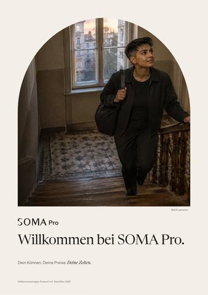 |
| 8 | **Customer app and SOMA Pro showcase**: screenshots of the app in the new brand (demo environment, captured 1 Nov 2026, v2 imagery, product AI labels visible) composed into boards labelled „Bilder KI-generiert · Demo-Daten“, plus the app-on-table environment | `showcase/customer-app.png`, `showcase/pro-dashboard.png`, `showcase/app-on-table.png` · raw captures `showcase/live/*.png` (`_src/capture-live.cjs`) | 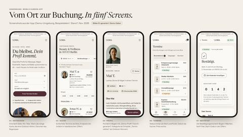 |
| 9 | **Landing page input** (not built here): key-visual directions, image per section, crop rules | `LANDING_ART_DIRECTION_INPUT.md` | 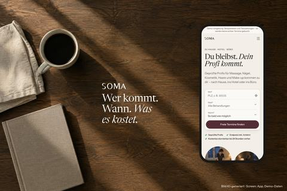 |
| — | **Motion identity**: principles, tokens, patterns, reduced motion, the no-count-up rule for money and ratings; specimen (mark draw-on with the new S-in-O) and storyboards | `motion/MOTION.md`, `motion/specimen.html`, `motion/storyboard-1…3.png` | 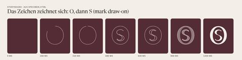 |

## Rules every application follows
- **One Oxblood moment per screen**: the app icon, the primary CTA, the brand band or the gift-card front. The booking confirmation and the Pro request card use Espresso, because nothing on them is the single primary action.
- **One serif statement per view.** UI, numbers and forms are set in Instrument Sans with tabular figures and German formats with no-break spaces (`54 €`, `18:30 Uhr`).
- **The arch crops photographs.** It never decorates, is never filled except as the brand moment, and never holds the logo.
- **Truth.** No invented ratings, badges or availability. Store icons are prepared assets: native apps are not built (the product is a PWA). Gift cards are labelled as a future concept. Payout and verification facts come from the product (`base-seed-data.ts`: documents, 20 / 12 / 5 % commission, 48 h payout hold).
- **AI labelling.** Every artwork with an AI photo carries „Bild(er) KI-generiert“: on the artwork itself (≥ 20 px on 1080 canvases), on every board, and as the platform label when published (`social/captions.md`).
- **No v1 imagery.** Applications load photographs only through `img.v2()` (the fetched v2 files in `public/images`); v1 paths are not reachable from `_src/`.
- **The signature.** Offset arch pair + Ortszeile in every campaign format (guidelines § 10.2), built with `signature()` in `_src/lib.mjs`.

## Build
| Script | Output |
|---|---|
| `_src/lib.mjs` | Shared kit: fonts (OFL files from `brand/assets/typography/fonts`; static instances in `_src/fonts-static/` for PDFs), colour tokens, `logo()`, `signature()`, `ortszeile()`, icons (Lucide geometry, ISC licence + the custom icons), Playwright `png()` / `pdf()` |
| `app-icons.mjs` · `social.mjs` + `grid.mjs` · `ads.mjs` + `ads-board.mjs` · `booking.mjs` · `email.mjs` · `giftcard.mjs` · `onboarding.mjs` · `motion.mjs` · `showcase.mjs` · `thumbs.mjs` | The folders above |
| `capture-live.cjs` | Live screenshots from the dev server (:3000, demo logins) |
